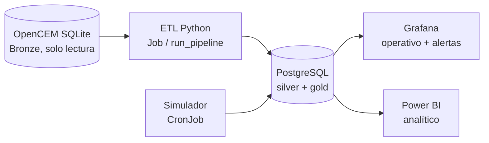

# SolarBI-Orquestado

Solución de Business Intelligence contenerizada y orquestada para analizar la **dependencia de la red eléctrica y los perfiles horarios de energía importada** de una microrred híbrida (solar + batería + red).

Taller 6 · Línea de profundización 4 · Inteligencia de Negocios, I.U. Pascual Bravo (2026-II).
Integrantes: Jaime Hoyos

---

## 1. Qué hace

1. Lee la telemetría real de inversores (OpenCEM v1.0.0, SQLite de ~4.4 GB) **en modo solo lectura**.
2. Integra la potencia en el tiempo para obtener energía **por hora** e inversor, con validación de calidad.
3. Carga un modelo dimensional en **PostgreSQL** (`silver` y `gold`) de forma idempotente y conciliada.
4. Expone dos capas de consumo:
   - **Grafana**: operación casi en tiempo real, con alertas y un simulador de datos nuevos.
   - **Power BI**: análisis para la gestión (balance, perfil horario, escenario de tarifa).
5. Todo corre en **Docker Compose** o en un **clúster local de Kubernetes**, con un comando para levantar y otro para eliminar.



## 2. Datos

| | |
|---|---|
| Fuente | OpenCEM: *Multimodal photovoltaic and battery microgrid dataset with context records and sky imagery*, v1.0.0 |
| DOI | [10.5281/zenodo.21436223](https://doi.org/10.5281/zenodo.21436223) |
| Licencia | Datos CC BY 4.0 (ver `data/documentation/LICENSE-DATA.txt`); código bajo la licencia de `LICENSE` |
| Instalación | Microrred en Longgang, Shenzhen (China) |
| Marcas de tiempo | Segundos Unix en UTC. La hora local de la instalación es `Asia/Shanghai` (UTC+8) y es la que usa el modelo |

Los datos **no se versionan en Git** (carpeta `data/` ignorada). Para reproducir:

```powershell
# 1) Descargar opencem-v1.0.0.sqlite.zst del registro de Zenodo a data/bronze/original/
# 2) Verificar contra data/checksums/opencem-v1.0.0-SHA256SUMS.txt
# 3) Descomprimir (requiere zstd)
zstd -d data/bronze/original/opencem-v1.0.0.sqlite.zst -o data/bronze/opencem-v1.0.0.sqlite
```

**Privacidad:** la tabla `context` incluye actividad de personas (inicios de sesión, escritorio remoto, repositorios). Esos tipos de evento **no se cargan**; solo los de red, batería y calidad de datos (9 tipos, ver `src/loading/load_context.py`).

## 3. Estructura del repositorio

```
├── Dockerfile · docker-compose.yml · .env.example
├── database/
│   ├── ddl/            01_schema · 02_eventos · 03_kpis · 04_vivo (.sql)
│   └── queries/        consultas de negocio (ventanas, comparativos, JSON)
├── src/
│   ├── config/         rutas y validación de la fuente
│   ├── extraction/     lector SQLite (solo lectura)
│   ├── transformation/ integración horaria y catálogo de variables
│   ├── validation/     chequeos de calidad del resultado
│   ├── loading/        cargadores idempotentes con conciliación
│   ├── simulation/     simulador de datos nuevos
│   └── orchestration/  run_pipeline.py (punto de entrada único)
├── grafana/provisioning/   fuente de datos, tableros y alertas (como código)
├── k8s/                    Kustomize: base + overlays dev y demo
├── scripts/                k8s-up.ps1 · k8s-down.ps1 · demo.ps1
├── powerbi/                proyecto Power BI (.pbip, formato de texto)
└── docs/                   perfilado de la fuente y hallazgos
```

## 4. Requisitos

- Docker Desktop. Para Kubernetes: activar *Settings → Kubernetes* en modo **kubeadm** (así las imágenes locales son visibles sin registro).
- Power BI Desktop (con el proveedor Npgsql) y DBeaver, en el anfitrión.
- Python 3.13 solo si se quiere ejecutar el ETL fuera de contenedores (`pip install -r requirements.txt`).

## 5. Configuración

```powershell
Copy-Item .env.example .env    
```

Las credenciales **nunca** van en el código ni en las imágenes. Con Compose se leen del `.env`; con Kubernetes, `scripts/k8s-up.ps1` crea el `Secret` desde ese mismo archivo. Los parámetros no sensibles (host, puerto, intervalo del simulador) viven en un `ConfigMap`.

## 6. Levantar la solución

### Opción A · Docker Compose

```powershell
docker compose build etl
docker compose up -d                    
docker compose run --rm etl              
docker compose --profile sim up -d simulador
```

Grafana: `http://localhost:3002` (usuario `admin`). PostgreSQL: `localhost:5434`.

### Opción B · Kubernetes (Docker Desktop, un nodo)

```powershell
docker compose build etl                 
.\scripts\k8s-up.ps1                     
kubectl -n solarbi-demo logs -f job/etl   
.\scripts\k8s-down.ps1                    
```

Grafana: `http://localhost:30300` (usuario `admin`). PostgreSQL: `localhost:30434` (DBeaver, Power BI).
Si PowerShell bloquea los scripts: `Set-ExecutionPolicy -Scope Process Bypass`.

| Necesidad | Objeto |
|---|---|
| Aislar | Namespace |
| Base de datos persistente | StatefulSet + PVC |
| Grafana sin estado propio | Deployment + ConfigMaps de *provisioning* |
| Credenciales | Secret (creado desde `.env`, fuera de Git) |
| Carga histórica | Job |
| Datos periódicos | CronJob (cada minuto, sin solapamiento) |
| Salud y recursos | probes y `requests/limits` |
| Acceso desde el anfitrión | Service NodePort |

Detalle y justificación en `k8s/README.md`.

### Prueba de reproducibilidad

```powershell
docker compose down -v && docker compose up -d && docker compose run --rm etl
```

## 7. Pipeline de datos

`python -m src.orchestration.run_pipeline` (o el Job de Kubernetes) ejecuta, deteniéndose ante el primer fallo:

1. **Transformación horaria** (`hourly_grid_energy`): integra la potencia con la regla del trapecio, partiendo cada tramo en los límites de hora local y calculando el cruce por cero de forma analítica. Un hueco mayor de **300 s** no se interpola, y un `NULL` nunca se convierte en 0.
2. **Validación** (`validate_hourly`): `net = positiva − negativa`, cobertura ≤ 60 min, clave única `(inversor, variable, hora)` y sin nulos.
3. **Carga de lecturas horarias**: *upsert* en `silver` y `gold`, con conciliación de conteos y sumas contra el CSV; si algo no cuadra, se revierte la transacción.
4. **Carga de eventos de contexto**: JSON original como `jsonb` en `silver`, y hecho de eventos en `gold`, también conciliado.

Ejecutarlo dos veces deja la base idéntica (idempotencia).

## 8. Modelo dimensional

| Capa | Objetos |
|---|---|
| `silver` | `energia_red_hora`, `context_evento` (`jsonb`), `lectura_vivo`, `control_simulador` |
| `gold` · hechos | `fact_energia_red_hora` (grano: inversor × variable × hora local), `fact_evento_operativo` (grano: un evento) |
| `gold` · dimensiones | `dim_fecha`, `dim_hora` (franja horaria, construida por el equipo), `dim_inversor`, `dim_variable` |
| `gold` · vistas | `vw_kpi_red_dia`, `vw_horas_sin_red_dia`, `vw_lectura_vivo` |

### Catálogo de variables

Cada variable se registra en `gold.dim_variable` con su unidad declarada y su estado. **Ninguna está `confirmada`** con el diccionario del fabricante.

| Variable | Uso | Estado y evidencia |
|---|---|---|
| `linepowerw_a` | Importación de red (base de la dependencia) | candidata: perfil alto de noche y casi nulo a mediodía; razón 0.81–0.91 con V×I |
| `pv1power` | Solar | candidata: razón 0.998 con V×I |
| `outw_a` | Carga atendida | candidata: razón 0.84 con V×I (factor de potencia) |
| `battpower_calc` | Batería (`battvolt × battcurr`) | candidata: signo confirmado con `battchgpower` (corriente negativa = carga) |
| `gridpowerw_a` | — | sin confirmar y **descartada**: no cuadra con su corriente (0.29–0.66) y su perfil es plano |

## 9. Indicadores

| Indicador | Definición | Observación |
|---|---|---|
| Energía importada | área positiva de `linepowerw_a` por hora | unidades de potencia × hora; kWh si la unidad resulta ser W |
| % red | red ÷ (solar + red + descarga de batería) | acotado entre 0 y 100 %, no depende de que el balance cierre |
| Disponibilidad del registro | % del día con telemetría | **no** es disponibilidad de la red |
| Horas sin red | suma de eventos `grid_unavailable_or_islanded` | eventos derivados de las mismas mediciones, no una fuente independiente |
| Balance energético | entradas − salidas | se muestra con una barra **"No explicado"** |

## 10. Consumo

**Grafana** (`grafana/provisioning/`, cargado automáticamente al arrancar): tablero histórico de la línea 4, tablero *Operación en vivo* con variable de inversor, y 4 reglas de alerta (una por inversor):

- *Red caída*: voltaje promedio < 100 V en 30 s (el mismo umbral que usa el dataset para `grid_unavailable_or_islanded`; nominal ≈ 235 V).
- *Telemetría en silencio*: más de 60 s sin lecturas.

Demostración con el simulador (cada fila lleva `modo_sim` para distinguirla de un dato real):

```powershell
.\scripts\demo.ps1 corte      # voltaje ≈ 0: "Red caída" pasa a Firing
.\scripts\demo.ps1 silencio   # sin datos: "Telemetría en silencio" pasa a Firing
.\scripts\demo.ps1 normal     # todo vuelve a Normal

```

**Power BI** (`powerbi/`, formato `.pbip`: modelo y páginas como archivos de texto versionables): conexión por **Importar** a PostgreSQL (`localhost:30434`), tabla de fechas propia, medida de inteligencia de tiempo (variación contra el mes anterior), 3 páginas con segmentaciones y *drill-down*, balance energético y parámetro de tarifa (*what-if*, **ilustrativo**).

## 11. Hallazgos principales

- La instalación está en Shenzhen: usar la hora de Bogotá desplazaba 13 horas el perfil horario. El perfil solar y el de red confirman el uso de `Asia/Shanghai`.
- El inversor 1 pierde el voltaje de línea el **3-may-2026 a las 15:51 (hora de Shenzhen)** y no lo recupera hasta su último dato (13-jul-2026). Los eventos de contexto solo cubren hasta el 9-jun. La causa no se puede determinar con la fuente.
- El inversor 2 deja de reportar valores desde mediados de mayo y se detiene el 22-jun-2026.
- El inversor 2 cambia de régimen de importación por tramos (≈ 16–30 mil unidades·hora por día a inicios de abril, ≈ 1.3 mil después), sin explicación en los datos.
- El balance de abril **no cierra** (la energía que entra supera a la que sale en ≈ 35 % y ≈ 60 % de la carga). Se presenta como resultado y no se ajusta.
- La frecuencia de muestreo cambia (≈ 12.6 s en abril, ≈ 60 s en mayo-junio, ≈ 11 s después).

Detalle en `docs/hallazgos_linea4.md` y `docs/perfilado_fuente.md`.

## 12. Limitaciones conocidas

- Unidades y significado de las variables **sin confirmar** con el diccionario del fabricante; los resultados se reportan como "unidades de potencia × hora".
- El umbral de 300 s para huecos es fijo: con muestreo de ~12 s puede puentear hasta ~24 lecturas perdidas.
- `es_hora_solar` (6–17 h) y las franjas horarias son supuestos fijos, sin considerar la variación estacional.
- Los contadores acumulativos del dataset (`linechgenergytotal`, etc.) tienen reinicios y nulos, y no se usan como fuente de energía.
- Grafana usa el usuario principal de PostgreSQL; falta un rol de solo lectura.
- Las alertas se ven en Grafana, pero no hay punto de contacto (correo o webhook) configurado.
- La tarifa de Power BI es ilustrativa.

## 13. Citación
##La licencia MIT no incluye los datos de la fuente, si los va utilizar siempre citar.
Bartels, T. S., Wu, R., Lu, X., Chen, Y., Lu, Y., Xia, F., Yang, H., Chen, Y., & Li, T. (2026). OpenCEM: Multimodal photovoltaic and battery microgrid dataset with context records and sky imagery (Version 1.0.0) [Dataset]. Zenodo. https://doi.org/10.5281/zenodo.21436223
